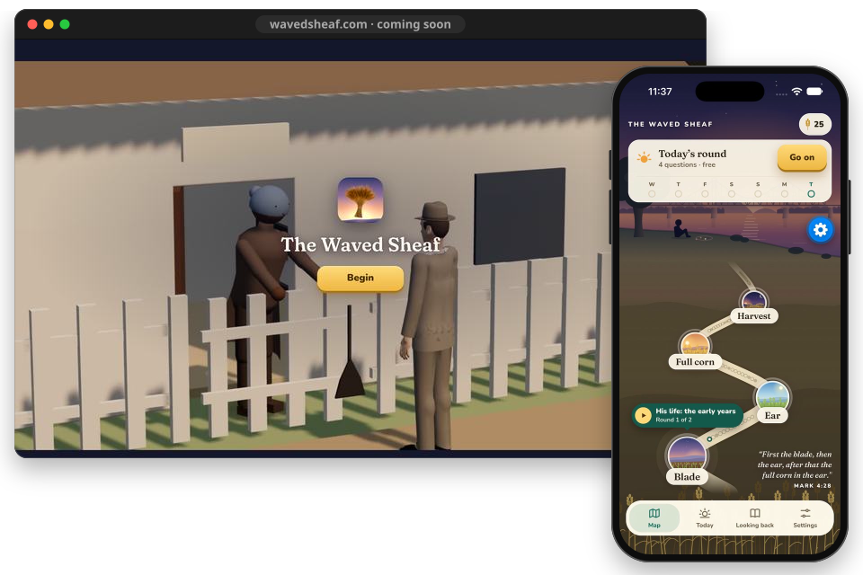
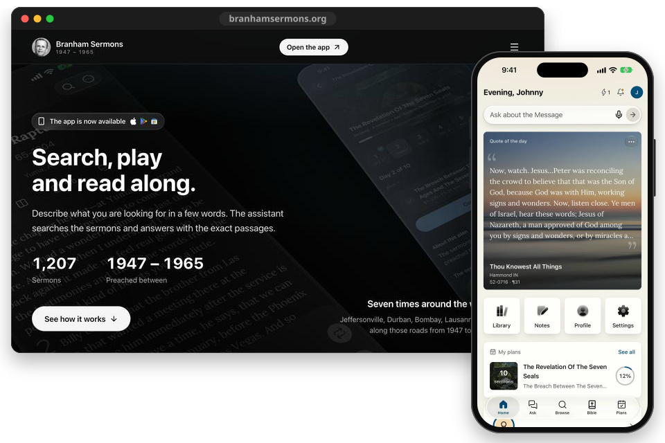
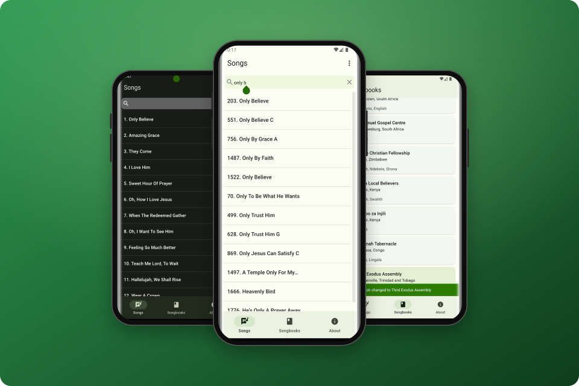
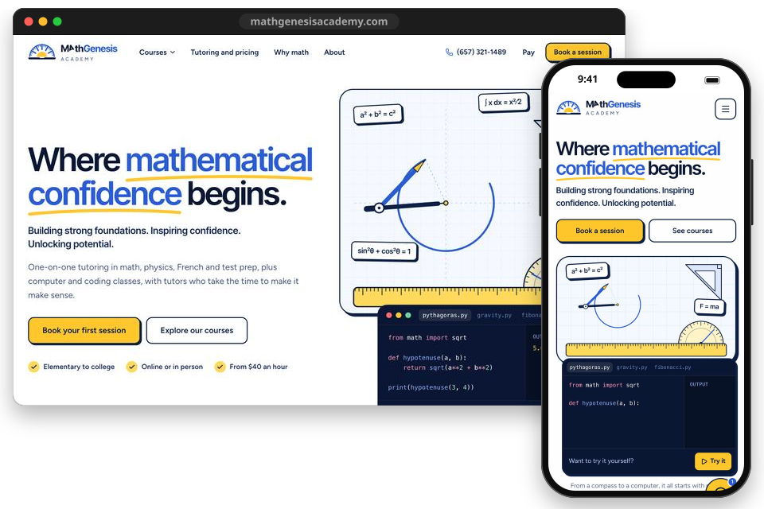
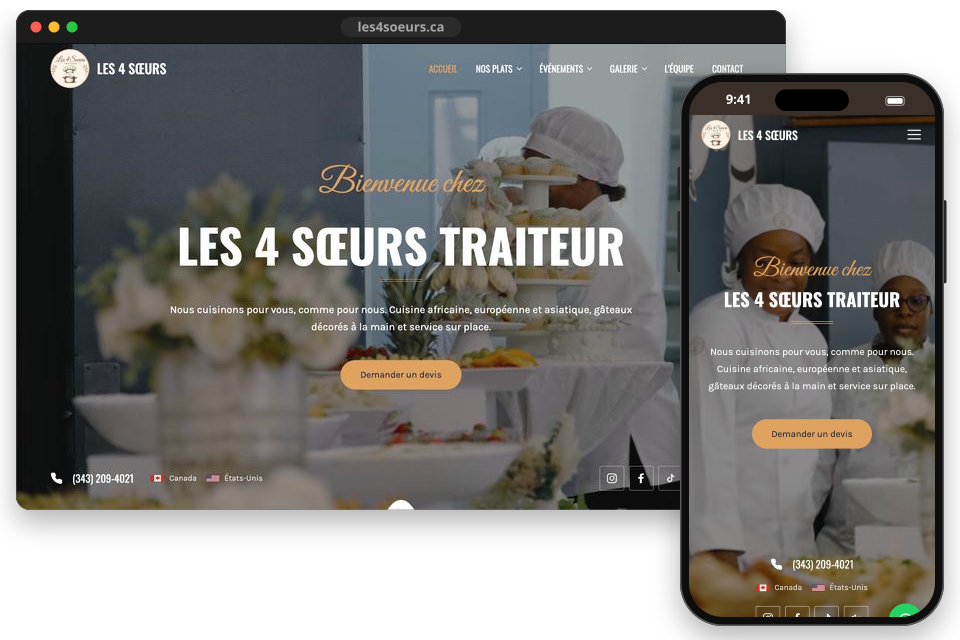

<a href="https://sadokdiba.dev">
  <picture>
    <source media="(prefers-color-scheme: dark)" srcset="assets/header-dark.svg">
    
  </picture>
</a>

  <a href="https://sadokdiba.dev"><b>sadokdiba.dev</b></a>
  &nbsp;·&nbsp;
  <a href="https://www.linkedin.com/in/sadokdiba">LinkedIn</a>
  &nbsp;·&nbsp;
  <a href="mailto:sadok.diba@gmail.com">sadok.diba@gmail.com</a>

I’ve worked in application support and software engineering since 2017. I build applications, mobile apps and websites for businesses and churches, and I stay on to run them after launch, servers included. I work in English and French.

Most of my code lives in private repositories, so here is some of what it runs.

### Selected work

<table>
  <tr>
    <td width="50%" valign="top">
      
      <h4>The Waved Sheaf &nbsp;in progress</h4>
      
A study game built on William Branham’s own words, in English and French, with daily rounds and stories in 3D. Coming to the web, iPhone and Android.

      React Native · Expo · React Three Fiber · three.js · Node.js · PostgreSQL
    </td>
    <td width="50%" valign="top">
      
      <h4><a href="https://branhamsermons.org">Branham Sermons</a></h4>
      
Search, read and listen to William Branham’s sermons in French and English, and ask questions in your own words. On iPhone, Android, Windows and the web.

      

        <a href="https://apps.apple.com/app/branham-sermons/id6815979276">App Store</a> ·
        <a href="https://play.google.com/store/apps/details?id=com.branhamsermons.app">Google Play</a> ·
        <a href="https://apps.microsoft.com/detail/9N97GL2STZ2N">Microsoft Store</a>
      

      React Native · Expo · Next.js · Node.js · PostgreSQL · pgvector
    </td>
  </tr>
  <tr>
    <td width="50%" valign="top">
      
      <h4><a href="https://songbookforbelievers.org">Songbook for Believers</a></h4>
      
A free songbook app for congregations around the world. I contribute to the open-source project: accounts that sync across devices, a first-run guide and Portuguese songbooks.

      

        <a href="https://apps.apple.com/us/app/songbook-for-believers/id1667531237">App Store</a> ·
        <a href="https://play.google.com/store/apps/details?id=com.ngonimujuru.songbook_for_believers">Google Play</a> ·
        <a href="https://apps.microsoft.com/detail/9mwtsgshzrz8">Microsoft Store</a>
      

      Flutter · Dart · Firebase · Cloud Firestore
    </td>
    <td width="50%" valign="top">
      
      <h4><a href="https://neuronelab.com">NeuroneLab</a> voice assistant</h4>
      
The bilingual assistant that answers NeuroneLab’s phone line day and night, books appointments and emails a summary after each call. Call it: +1&nbsp;438&#8209;901&#8209;4664.

      TypeScript · Node.js · Fastify · Twilio · Retell AI · Docker
    </td>
  </tr>
  <tr>
    <td width="50%" valign="top">
      
      <h4><a href="https://mathgenesisacademy.com">MathGenesis Academy</a></h4>
      
Platform for a tutoring academy: a portal where students, parents and tutors sign in for timetables, assignments and feedback, and a public site with interactive lessons.

      Next.js · Cloudflare Workers · Hono · Drizzle · Firebase Auth
    </td>
    <td width="50%" valign="top">
      
      <h4><a href="https://les4soeurs.ca">Les 4 Sœurs</a></h4>
      
Bilingual website for an African catering business in Montréal, Gatineau and Toronto, with menus, past events, a chat assistant and quote requests.

      Next.js · TypeScript · Tailwind CSS · Cloudflare Workers
    </td>
  </tr>
</table>

### Stack

<b>Apps and front end</b>  
<picture>
  <source media="(prefers-color-scheme: dark)" srcset="assets/stack-apps-dark.svg">
  
</picture>

<b>Back end and data</b>  
<picture>
  <source media="(prefers-color-scheme: dark)" srcset="assets/stack-backend-dark.svg">
  
</picture>

<b>Servers and cloud</b>  
<picture>
  <source media="(prefers-color-scheme: dark)" srcset="assets/stack-servers-dark.svg">
  
</picture> 
Linux servers I run myself: systemd, PM2, Nginx, Cloudflare Tunnel, SSH, firewalls and CI/CD with GitHub Actions.

 

More work, and the story behind it, at <a href="https://sadokdiba.dev">sadokdiba.dev</a>

